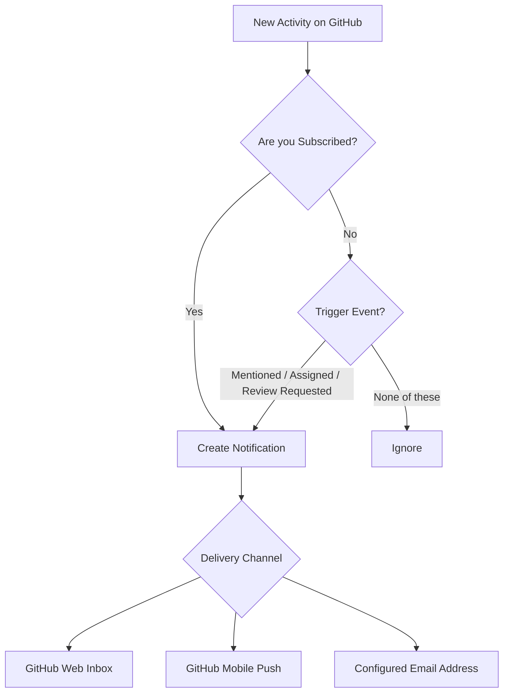
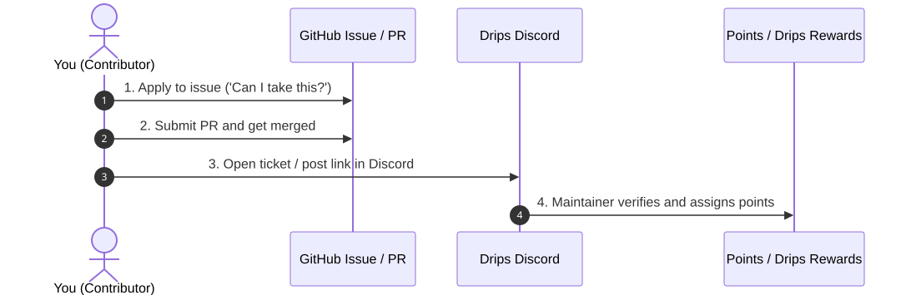
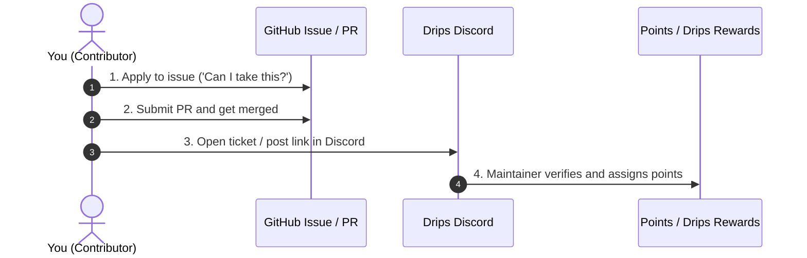
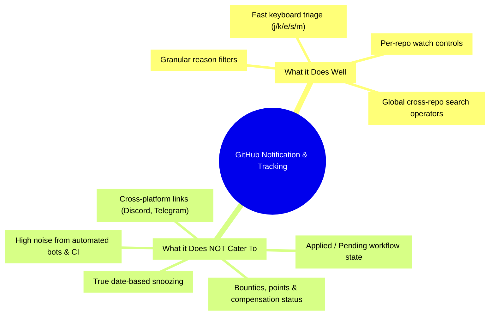

# Deep Dive: GitHub Notifications, Search Architecture & Cross-Platform Contribution Tracking

---

## 1. How GitHub Notifications Work Under the Hood

GitHub notifications are driven by an **event-subscription matrix**. Whenever activity occurs on a repository, issue, pull request, or discussion, GitHub calculates whether you receive an update based on three core concepts:



<details>
<summary>View Diagram Source (Mermaid)</summary>


</details>

### 1.1 Subscription Triggers
You are automatically subscribed to a thread when:
1. **Participating**: You commented, created the issue/PR, opened a review, or committed code to the branch.
2. **Mentioned**: Someone tags your username (`@username`) or a team you belong to (`@org/team`).
3. **Assigned**: A maintainer formally assigns the issue or PR to you.
4. **Review Requested**: You are requested to review a pull request.
5. **Watching a Repository**:
   - **Participating and @mentions only**: Default for new repos you interact with.
   - **All Activity**: Alerts for every issue, PR, discussion, commit, and release.
   - **Custom**: Granularly pick (e.g., only *Releases*, *Discussions*, *Issues*, or *Pull Requests*).
   - **Ignore**: Completely silences all notifications, even mentions.

### 1.2 Thread Lifecycle & States
- **Subscribed (`reason`)**: Each notification has a machine-readable reason tag (e.g., `mention`, `assign`, `author`, `review_requested`, `comment`, `ci_activity`).
- **Unsubscribed / Muted (`m`)**: You stop receiving follow-up notifications on that specific thread, *unless* someone explicitly `@mentions` you again.
- **Done (`e`)**: Archives the notification out of your active inbox. If someone comments on it again later, it will pop back into your Inbox.

---

## 2. Navigating the Notifications Interface (`github.com/notifications`)

The GitHub notification inbox is modeled after **Email / GTD (Getting Things Done)** triage.

### 2.1 The Three Core Buckets
| Bucket | Shortcut | Purpose |
| :--- | :--- | :--- |
| **Inbox** | Default | Needs your triage or attention right now. |
| **Saved** | `s` | Items you cannot resolve immediately, or want to keep handy as active reference. |
| **Done** | `e` | Cleared/archived items. They remain searchable, and new comments bring them back. |

### 2.2 Pro-Tier Keyboard Shortcuts
Enable GitHub keyboard shortcuts (`?` to view cheat sheet) to triage notifications in seconds:
- `j` / `k`: Move down / up through the list.
- `e`: Mark selected notification as **Done**.
- `s`: **Save** / unsave selected notification for later.
- `m`: **Unsubscribe** (mute) from the conversation.
- `Shift + u`: Mark as **Unread**.
- `Shift + i`: Mark as **Read**.
- `Enter`: Open the thread in a new tab.

### 2.3 Powerful Filter Bar Queries
Inside `github.com/notifications`, you can use native search syntax in the filter input:

```text
# Filter by reason
reason:mention
reason:review-requested
reason:assign
reason:author

# Filter by state
is:unread
is:open
is:done
is:saved

# Filter by repo
repo:drips/drips-app
repo:org-name/*
```

> [!TIP]
> You can create **Custom Filters** on the left sidebar: click **Manage notifications > Filters** to save custom views like `is:open reason:author` for quick access.

---

## 3. Finding "Lost" Issues You Applied To & PRs You Submitted

Notifications only capture **recent events**. If maintainers never responded, closed an issue silently, or your inbox cleared out, notifications won't help. 

Use **Global GitHub Search** (`github.com/search` or the global search bar `/`):

### 3.1 Queries for Issues You Applied To
In open source, "applying" usually means commenting on an issue asking to be assigned:
- **All issues you commented on (Open & Active)**:
  ```text
  is:issue commenter:@me is:open
  ```
- **Issues where you commented but are NOT assigned**:
  ```text
  is:issue commenter:@me -assignee:@me is:open
  ```
- **Issues where you were officially assigned**:
  ```text
  is:issue assignee:@me is:open
  ```
- **All issues involving you in any way**:
  ```text
  is:issue involves:@me
  ```

### 3.2 Queries for PRs You Submitted
- **Your active PRs awaiting maintainer review**:
  ```text
  is:pr author:@me is:open draft:false
  ```
- **Your PRs with requested changes (blocked on your updates)**:
  ```text
  is:pr author:@me is:open review:changes_requested
  ```
- **Your merged PRs (vital for claiming points/bounties)**:
  ```text
  is:pr author:@me is:merged sort:updated-desc
  ```
- **Closed without merge (rejected or stale)**:
  ```text
  is:pr author:@me is:closed is:unmerged
  ```

> [!IMPORTANT]
> Bookmark these search URLs in your browser or add them as custom GitHub links for 1-click access anytime!

---

## 4. Solving the Cross-Platform Problem: Drips, Discord, and Bounty Tracking

### 4.1 The Core Problem
Ecosystems like **Drips**, Web3 grant protocols, bounty boards, and open-source contribution hubs require a multi-step lifecycle across disconnected platforms:



<details>
<summary>View Diagram Source (Mermaid)</summary>


</details>

GitHub has **no native awareness** of Discord, reward tiers, Drips streams, or points. If you rely solely on GitHub notifications, steps 3 and 4 will inevitably fall through the cracks.

---

### 4.2 Recommended Solutions & Workflows

#### Option A: Personal GitHub Projects (Free, Native & Zero Setup)
GitHub allows you to create personal project boards that span **any repository across GitHub**:
1. Go to `github.com/users/<your-username>/projects` > **New project** (Table or Board view).
2. Add custom fields:
   - **Stage**: `Applied` → `In Progress` → `PR Merged` → `Discord Ticket Open` → `Points Claimed`
   - **Discord Channel / Ticket ID**: Text or URL field
   - **Points / Reward**: Number field (e.g. `100 Drips` or `$150`)
3. You can paste any issue or PR URL directly into this project table, and GitHub will automatically pull live titles, avatars, and open/closed status.

#### Option B: GitHub CLI (`gh`) Automation
If you prefer a terminal workflow, run quick scripts to inspect your contributions:
```bash
# List your 10 most recent merged PRs
gh search prs --author "@me" --state merged --limit 10

# List issues you commented on in a specific org
gh search issues --commenter "@me" --owner "drips" --state open
```

#### Option C: Dedicated Discord Claiming Checklist
Keep a simple markdown template (in your notes app or a private tracking repo):

| Issue / PR Link | Repo | Status | Discord Claim Link / Ticket | Points |
| :--- | :--- | :--- | :--- | :--- |
| `repo#12` | `drips/frontend` | Merged ✅ | Discord #contributions-claim | 250 pts |
| `repo#45` | `drips/contracts` | In Review ⏳ | Pending merge | TBD |

---

## 5. What GitHub Caters To vs. What It Fails At



<details>
<summary>View Diagram Source (Mermaid)</summary>


</details>

| Area | What GitHub Caters To | Where GitHub Falls Short | Recommended Fix / Workaround |
| :--- | :--- | :--- | :--- |
| **Tracking Applications** | Issues assigned to you (`assignee:@me`). | When you comment "can I take this?" before being assigned. | Search `is:issue commenter:@me -assignee:@me is:open`. |
| **PR Follow-ups** | Direct review comments, mentions, CI failure pings. | Reminding you to check back in 3 days if maintainers are unresponsive. | Use GitHub personal project board or third-party reminder bot. |
| **Discord / Drips Point Systems** | Zero native support for Discord or external rewards. | Cannot attach external status (points, bounties, Discord tickets) to PRs. | Personal GitHub Projects with custom fields for Discord ticket links and Points. |
| **Notification Snoozing** | "Save for later" (`s`) bucket. | Cannot snooze until a specific date/time (e.g., "remind me next Monday"). | Use third-party tools (Octobox, Linear Sync) or calendar tasks. |
| **Bot & CI Noise** | Filters like `-reason:ci-activity`. | Many bots comment as normal users, polluting notifications. | Add custom search filter: `-author:app/dependabot -author:app/stale`. |
